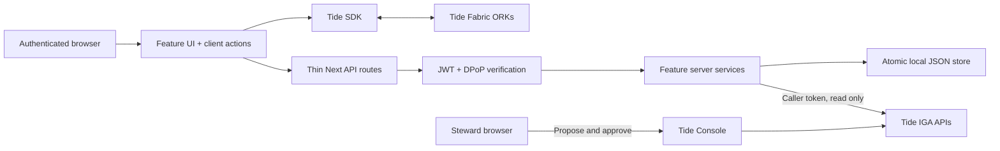

# Hostless Hui architecture

## Boundaries

A single Next.js 16.4.2 App Router application runs on Bun 1.4 with React 19.3.1 and Tailwind CSS 4.
Installed shadcn/Radix primitives render the UI. TideCloak runs separately in Apple `container`;
the Tide Fabric's ORKs evaluate cryptographic requests. Release services are designed to persist
ciphertext and signed policies, not plaintext packages or encryption keys; a live shared
sign/encrypt/decrypt path has not yet been accepted. Money, contributions and escrow redemption
are synthetic; no payment provider is integrated.

## Feature-first structure

| Boundary | Owns |
|---|---|
| `src/features/auth` | `types.ts`; `client/use-tide-session.ts`; `components/auth-callback.tsx`, `session-header.tsx`; `server/tide-config.ts`, `verify-tide-jwt.ts`, `dpop-primitives.ts`, `verify-dpop.ts`, `with-auth.ts`, `identity.ts`, `demo-users.ts`. |
| `src/features/circle` | `model.ts`, `types.ts`; `client/use-circle.ts`; `server/circle-service.ts`; `components/circle-page.tsx`, `circle-workspace.tsx`, `cycle-selector.tsx`, `event-history.tsx`. |
| `src/features/releases` | `types.ts`; `client/release-actions.ts`, `relationship.ts`; `server/policy-validation.ts`, `record-id.ts`, `persistence.ts`, `release-service.ts`; `components/sealed-package.tsx`, `policy-row.tsx`, `opened-release-dialog.tsx`. |
| `src/features/governance` | `types.ts`; `server/governance-service.ts` reads pending/approved change requests and roles with the caller token, maps Tide `entityId` (user UUID) plus `rows[{ROLE_ID,USER_ID}]` through exact role UUID/name to each matching cycle's `recordIds[]` (including multi-cycle rows); `change-request-card.tsx` and `proof-panel.tsx` label this Tide approval history, not current entitlement. |
| `src/features/escrow` | `server/redeem-service.ts`; `components/redemption-action.tsx`; redemption is synthetic. |
| `src/app/api` | Thin route adapters in `config`, `circle`, `members`, `policies`, `payouts`, `governance`, `admin-policy` and `escrow/redeem`. |
| `src/lib/client/tide-api.ts` | Shared Tide API transport. |
| `src/lib/server` | `request-body.ts`, `guards.ts`, `api-errors.ts`, `rate-limit.ts`, `atomic-json.ts`; shared request handling and local persistence infrastructure. |
| `src/components/ui` | Installed shadcn/Radix primitives only; feature-specific product UI stays in its owning feature. |
| `scripts/tide` | Local realm bootstrap and enrollment utilities only; never imported by application request handlers. |

Feature modules keep their client, server and product UI code under their own boundary; shared
types/contracts are explicit. Route files delegate to feature services. Server code does not import
client SDK actions, and UI components do not receive admin credentials. Cross-feature dependencies
use named contracts rather than another feature's private persistence format.

### Tide change-request mapping

The governance read model fetches both `PENDING` and `APPROVED` changes and role definitions
using the caller token. It maps the actual Tide request shape (`entityId` is a user UUID; each
row carries `ROLE_ID` and `USER_ID`) through exact role UUID/name to cycle `recordIds[]`, so one
change may map to multiple cycles. It does not treat a payout ID as `entityId`. The UI calls an
`APPROVED` result Tide approval history; it does not assert that the role is a current entitlement.

The governance upstream-JSON parsing cap is 1 MiB for large Tide histories; public app request
bodies remain capped at 64 KiB. A payload smoke parsed an actual 269-record approved-history
response (244,463 bytes). A harmless `c4` proposal was inspected and denied without authorization;
the resulting denied change request mapped to `payout-c4` with 0/1 approved. The final credential-free
source export passed typecheck, lint, 15 tests across seven files with 39 expectations, and production
build. Policy tests use isolated matching-vendor adapters instead of the live local configuration.
Details: [clean-checkout verification](../plans/20261022-1026-challenge-2-tidecloak-app/reports/clean-checkout-2026-10-22.md).
Production browser smoke at 1280x900 and 375x812 reported no horizontal overflow; public config
returned 200, unauthenticated circle returned 401 with `no-store`, and the reviewed relay returned
200. Sign-in reached the ORK without credentials. One Keycloak iframe `ERR_ABORTED` and URL-wait
timeout were observed; see the
[production smoke report](../plans/20261022-1026-challenge-2-tidecloak-app/reports/production-smoke-2026-10-22.md).
These checks do not prove an enrolled end-user flow, steward quorum or live release.

## Runtime security

- Application requests verify EdDSA access tokens against the local adapter's public Tide JWKs.
- Required claims include issuer, client, subject and expiry; DPoP verifies request binding and replay protection.
- DPoP replay-JTI retention covers proof `iat` plus allowed clock skew; the replay-TTL scenario passed after the fix.
- Steward access checks the `tide-realm-admin` client role of `realm-management`, not an arbitrary same-named realm role.
- Master-admin credentials are bootstrap-only, read by local scripts under `scripts/tide`; they are never used by application runtime or approval handlers.
- JWT/DPoP boundary tests use ephemeral synthetic issuer and proof keys. They do not establish interoperability with a live Tide issuer or an enrolled user.
- Signed read policies and ciphertext are intentionally visible to authenticated synthetic-circle members. This is intended to permit ORK-denial testing rather than disguise an API denial as cryptographic enforcement.
- Policy metadata is validated at storage; the ORKs enforce cryptographic policy authenticity when a real release request runs.
- Local storage serializes writes and uses atomic file replacement. Synthetic redemption is beneficiary-bound and single-use.
- Browser API requests are same-origin and sender-bound. Raw setup responses and enrollment links remain ignored/private.
- A committed, persistent Bun patch for pinned `@tidecloak/js@0.14.33` covers both ESM and CJS bundles. It disables optional JavaScript-readable `kcToken` persistence by clearing the legacy cookie while preserving front-channel login, DPoP and E2EE. Cookie smoke passed on both bundles; keep the patch while this version is pinned, and use `bun install` to apply it.

### Dependency audit

On 2026-10-22 after removing an accidental root Playwright dependency, `bun audit --production`
exited 0 with no vulnerabilities across 92 production packages. The full `bun audit` still reports
one high-severity development-tool advisory for `braces@3.0.3`, reachable through
`eslint-config-next` → `@next/eslint-plugin-next` → `fast-glob` → `micromatch` → `braces@3.0.3`.
The source is [GHSA-vfj7-8cjw-p6xm](https://github.com/advisories/GHSA-vfj7-8cjw-p6xm), which
affects versions through 3.0.3 and lists no patched version; npm's latest version was also 3.0.3
when checked. The finding is dev-tool-only, but the full dependency audit is not clean. Recheck for
an upstream patched release rather than suppressing or hiding the advisory.

## Policy and release flow

1. A human steward signs a write policy for the escrow identity and a read policy for the cycle-winner role.
2. The escrow identity generates a synthetic release code in its browser, encrypts the package and uploads ciphertext plus code hash.
3. Members may attempt decryption using that signed read policy. The ORKs decide whether the current identity and roles match.
4. Stewards propose and approve role changes in the Tide Console; the application reads actual request status.
5. The beneficiary refreshes its Tide token, decrypts the package and redeems the synthetic code.

The steps below describe the implemented path, not a completed live acceptance: no successful
enclave-signed policy, shared encryption/decryption, observed quorum or alternate-policy test has
yet been recorded. Code availability alone does not prove resistance to alternate-policy grants.

## Honest limitations

- Authentic browser code and an uncompromised client device are assumed. A malicious script-delivery operator
  can target plaintext before encryption or after authorized decryption.
- A colluding authorized quorum can grant access by design. Quorum size must be measured, not inferred.
- A sealer knows the plaintext it authored; encryption does not make it forget the code.
- Role approval governs access, not the business correctness of the encrypted financial instruction.
- Role changes may take up to 120 seconds to propagate. Plaintext already disclosed cannot be revoked.
- Tide's master-realm recovery behavior is outside any claimed "operator cannot override" guarantee until tested.
- Tide SDK front-channel behavior remains browser-side. The local patch addresses the observed optional `kcToken` persistence path, but does not replace production review of SDK configuration and session handling.
- Current storage and in-memory replay/rate-limit state support one process, not a multi-instance deployment.

## Scaling decision

Keep one application process and local JSON for the hackathon. Add Postgres for transactional persistence,
a shared replay/rate-limit store for multiple instances, and a managed HTTPS deployment only when needed.
No event bus, sharding, microservices or generic repository abstraction is needed for three synthetic records.
