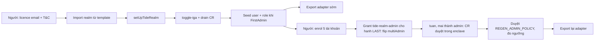

# Phase 01: Realm TideCloak, enrol, quorum

## Context Links

- `research/researcher-04-raziel-build-path.md` §2 (lệnh HTTP-only), §8; `research/researcher-01-tidecloak-technical.md` (API provisioning)
- Mirror: `.cache/raziel/templates/templates/shared/{bootstrap-tidecloak.sh,realm.json.template,tide-doctor.sh}`, `.cache/raziel/canon/{tidecloak-bootstrap,iga-change-requests-api,concepts}.md`, `.cache/raziel/playbooks/{start-tidecloak-dev,bootstrap-realm-from-template,initialize-admin-and-link-account}.md`
- Server: container `mytidecloak` (Apple `container`), `http://localhost:8080`, `myrealm` có sẵn (**không dùng**).

## Overview

- Priority: P1 · Status: Pending · 12:20–14:00 · Workstream **T** · **G1 14:00**
- Tạo realm `hui-rmit26` đã licence + IGA, seed user/role, enrol 5 tài khoản, nâng 3 steward lên `tide-realm-admin`, **đo ngưỡng quorum thật**, export adapter (sớm, rồi export lại).

## Key Insights

- **Không chạy** `bootstrap-tidecloak.sh`/`init-tidecloak.sh` (Step 0 `docker stop/rm` + xóa H2; Step 1 `docker run`). Dùng lệnh HTTP, giữ nguyên container. **Không `container rm`** (H2 nằm trong filesystem của container, không có volume): restart/stop an toàn, xóa thì mất realm và phải bootstrap + enrol lại (~40 phút). Kiểm `container inspect mytidecloak` để xác nhận không có mount.
- Thứ tự: **seed hết khi còn FirstAdmin** (server drain CR), enrol, ký IdP, grant `tide-realm-admin` cho admin đầu **cuối cùng** (flip một chiều sang multiAdmin). Sau flip mọi thay đổi governed cần enclave của người (AP-89); master token không còn là đường duyệt.
- Với IGA, **2xx = ACCEPTED chưa APPLIED**: drain CR rồi đọc lại (canon `concepts.md:170`).
- Ngưỡng **sống** nằm trong policy `tide-realm-admin`, chỉ đổi khi CR `REGEN_ADMIN_POLICY` (liên kết qua `relatedPolicyCrId` với lần grant admin) được commit; `max(1,floor(0.7·N))` chỉ là dự phóng (`iga-change-requests-api.md:199`). **Chấp nhận "2 of 3" chỉ khi quan sát được: phiếu 1 không commit, phiếu 2 commit.**
- `iga-core` không cấm người đề xuất tự duyệt (`:190`) ⇒ "2 phiếu" phải là 2 steward khác nhau.
- Enrol cần Internet tới ORK (`https://ork1.tideprotocol.com`), mỗi người vài phút [INFERENCE]; role mới vào token ≤ 120 s.
- Có **đường thoát** của Tide: master-realm admin tắt được IGA trên realm khi bị khóa (`tidecloak-bootstrap.md:327–345`): chỉ dùng để cứu, không dùng làm đường vận hành, và không đưa vào lời tuyên bố.

## Requirements

- Realm `hui-rmit26` licensed, IGA on; user `hanh`, `tuan`, `mai` (steward), `minh` (người thắng), `bao` (escrow); role `hui-c1-winner`, `hui-c3-winner`, `hui-c4-winner` (thêm `c2` nếu rảnh); `bao` có `_tide_encryptor`; **không ai** có `_tide_decryptor`; 3 steward là `tide-realm-admin`; adapter đủ `jwk`, `vendorId`, `homeOrkUrl`, `client-origin-auth-*`.
- Lệnh chép lại được trong `docs/setup-tidecloak.md`; secrets chỉ ở `.env` (gitignored).

## Architecture

## Related Code Files

- Tạo (T): `docs/setup-tidecloak.md` (lệnh đã chạy + số đo), `scripts/tide/lib.sh` (get_token, approve_all_pending), `scripts/tide/seed-realm.sh`, `.env` (ignored), `data/tidecloak.json` (ignored)
- Sửa: `.gitignore` (`.env*`, `data/tidecloak.json`, `.tide-pack/`)

## Implementation Steps

1. Chỉ bắt đầu sau phase 00 (email + T&C). `.env`: `KC_BOOTSTRAP_ADMIN_PASSWORD`, `TIDE_LICENSE_EMAIL`, `TIDE_TERMS_ACCEPTED=yes` (sau khi người dùng nói đồng ý).
2. Biến: `TIDECLOAK_URL=http://localhost:8080 REALM_NAME=hui-rmit26 CLIENT_NAME=hui-rmit26-client CLIENT_APP_URL=http://localhost:3000`.
3. Import realm bằng `jq walk` + `POST /admin/realms`; `setUpTideRealm` (form-urlencoded; từ chối `NEED_PAYMENT`/non-2xx); `iga.attestor=tide` + `toggle-iga` đúng một lần (đọc trạng thái trước, assert `"enabled":true`); `approve_all_pending` (research-04 §2 bước 1–3).
4. Seed khi còn FirstAdmin: 5 user (`tideInvitable=["true"]`), các role winner, grant `_tide_encryptor` cho `bao`; sau mỗi lô: drain + GET đọc lại (APPLIED).
5. **~12:45 export adapter sớm** (`get-installations-provider`) vào `data/tidecloak.json` để phase 02 chạy G2b; sẽ export lại sau khi đổi origin/flip.
6. Mint invite cho 5 user (`get-required-action-link`, lifespan 43200) và gửi DM; mỗi người mở ở **profile riêng**; poll `tideUserKey`. Thử **popup enclave** với tài khoản đầu tiên trước khi flip.
7. `CustomAdminUIDomain` + `sign-idp-settings` (**[UNVERIFIED]** app-origin vs console-origin: thử giá trị của script rồi giá trị còn lại).
8. **Flip có người chứng kiến (≈ 13:30):** `hanh` có mặt, `tuan`/`mai` đã link và có profile sẵn; grant `tide-realm-admin` cho `hanh` cuối cùng, drain; đặt hạn 15 phút: nếu enclave của `hanh` không duyệt được thì dừng, dùng đường cứu (master-realm admin) theo canon rồi enrol lại, không kéo dài hơn mốc 14:00.
9. Thêm `tuan`, `mai` làm admin: role-mapping ⇒ CR PENDING ⇒ `hanh` (rồi `tuan`) duyệt trong Tide Console; tìm và duyệt `REGEN_ADMIN_POLICY` liên quan.
10. **Đo ngưỡng thật** bằng một CR thử (grant role giả, thu hồi sau): ghi `threshold`, `authorizationCount`; xác nhận phiếu 1 chưa commit, phiếu 2 commit. Ghi vào `docs/setup-tidecloak.md` mục "Measured behaviour". Export lại adapter. **G1 14:00.**

## Todo List

- [ ] Realm import + licence (NEED_PAYMENT = no-go)
- [ ] IGA on, CR baseline drained
- [ ] Seed đúng (không `_tide_decryptor` thường trực), đọc lại APPLIED
- [ ] Adapter sớm đã export
- [ ] 5 tài khoản link (`tideUserKey`), popup enclave OK
- [ ] Flip multiAdmin có người chứng kiến, 3 steward là admin
- [ ] Ngưỡng đo: phiếu 1 không commit, phiếu 2 commit

## Success Criteria

- `GET …/users` thấy 5 user có `tideUserKey`; PENDING rỗng; adapter có `jwk`; CR thử cho thấy ngưỡng ≥ 2 (hoặc ghi nhận ngưỡng 1 và README đổi theo).

## Risk Assessment

- ORK không với tới/chậm: kiểm Internet, hỏi Discord kèm `container logs mytidecloak`.
- Licence `NEED_PAYMENT`/303: sai email hay chưa đồng ý T&C, không dùng email giả.
- Enrol kẹt/invite hết hạn: link mới; không dùng SMTP.
- Popup enclave hỏng: đổi `CustomAdminUIDomain`, ký lại.
- Flip xong mà `hanh` không duyệt được: đường cứu của Tide (master-realm admin tắt IGA) rồi dựng lại; ghi nhận thời gian mất.
- Ngưỡng sống = 1: không nói "2 of 3"; README chỉ nêu số đo.
- Mất container: bootstrap + enrol lại (~40 phút); không `container rm`.

## Security Considerations

- Mật khẩu admin dev chỉ local (bind `127.0.0.1:8080`); invite link là bearer: gửi DM, không dán vào repo/log; không commit email licence; tên user giả.

## Next Steps

Phase 03 cần adapter + `hanh` đã flip (G1.5) và 3 steward (G3). Nếu enrol chậm, phase 02/04 vẫn chạy trên scaffold.
