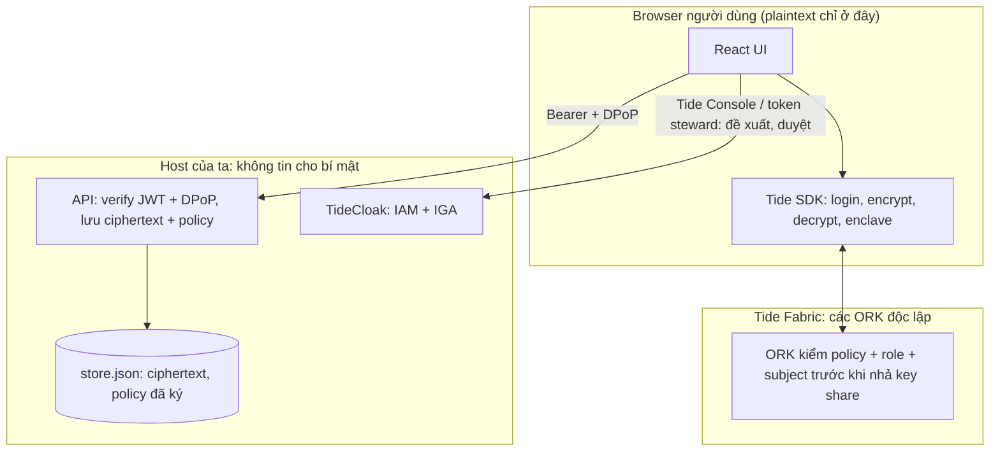

# Phase 02: Nền app trên Bun

## Context Links

- `research/researcher-04-raziel-build-path.md` §1, §3, §4; mirror `.cache/raziel/scaffold/nextjs-e2ee-vault.md`, `.cache/raziel/templates/templates/{nextjs-e2ee-vault,dpop-verify,relationship-attestation}/`, `.cache/raziel/canon/{invariants,version-policy,redirect-handler,tidecloak-bootstrap}.md`
- Quy tắc repo: `CLAUDE.md` (Bun), file < 200 dòng, kebab-case.

## Overview

- Priority: P1 · Status: Pending · 12:20–13:40 · Workstream **B** · **G2b 13:40**
- Thay starter bằng scaffold Tide chạy dưới Bun; login + DPoP + verify JWT thật; khung lưu ciphertext/policy **tái dùng mẫu của scaffold**.

## Key Insights

- Đường A (khuyến nghị): scaffold `nextjs-e2ee-vault` có provider, `/auth/redirect`, route DPoP + CSP, `withAuth/withRole`, route vault lưu ciphertext bằng JSON file (`src/app/api/vault/route.ts`). Ghim `@tidecloak/nextjs@0.14.17`, `next dev --webpack`; **không nâng version**. Độ tương thích Bun 1.4 + Next 16 là **[UNVERIFIED]**.
- Gate đúng nghĩa cần **adapter thật**: `providers.tsx` import tĩnh `data/tidecloak.json`; thư mục `data/` chỉ có `.gitkeep`. Trước khi adapter có (phase 01 xuất sớm ~12:45), dùng **placeholder biên dịch** theo `tidecloak-bootstrap.md:38` để tách lỗi scaffold khỏi lỗi Bun.
- Đường B (dự phòng) là một **implementation thứ hai**, giới hạn **60 phút** và phải qua trọn gói: login + route bảo vệ + DPoP. Skeleton ở research-04 §4. `import index from "./index.html"` là `HTMLBundle`, không đặt header trực tiếp được.
- `public/tide_dpop_auth.html` phải chép nguyên byte, SHA-256 `9d7844b938f0a2565fa910d3d30e9b8797cbfd6e0b73d59d804169a089aea757` (9.120 byte; đã kiểm bản trong pack). Checker nằm ở pack: `.cache/raziel/templates/scripts/check-dpop-asset.sh`, không nằm trong repo sau khi copy.
- Bun không chạy lifecycle script mặc định; file `silent-check-sso.html` đã có sẵn trong template.
- Hoãn tới phase 05 nếu dư giờ: token-bucket, idempotency generic, events API, test hạ tầng (không nằm trên đường găng chứng minh quorum).

## Requirements

- `bun install && bun run --bun dev` lên `http://localhost:3000`; login Tide hoàn tất; API bảo vệ trả 401/403/200 đúng.
- Lưu: ciphertext và policy đã ký trong `data/store.json` qua `node:fs` (chạy được dưới Bun và Node); policy phục vụ **mọi thành viên đã xác thực** (metadata công khai trong circle) để phép thử từ chối thật sự đến từ ORK (xem phase 03).

## Architecture

Mô hình dữ liệu tối thiểu: `payouts[{recordId, ciphertext, sealedAt}]`, `policies[{subjectType, subjectId, recordId, policyBytes(base64)}]`, `escrow[{cycle, beneficiarySub, codeHash, paid}]` (mock). Không lưu plaintext/token/doken. Đánh đổi: một node, CP, không Kafka/sharding (YAGNI); đường mở rộng: JSON → Postgres, replay-store DPoP sang Redis, API stateless.

## Related Code Files

- Xóa (cutover, sau khi G2a đạt; đặt tag `starter-bun` trước): `src/index.ts`, `src/App.tsx`, `src/APITester.tsx`, `src/frontend.tsx`, `src/index.html`, `src/index.css`, `src/*.svg`, `bunfig.toml`, `bun-env.d.ts`, `tsconfig.json`, `package.json`, `bun.lock`
- Từ template (`cp -Rn`, không ghi đè `README.md`, `.gitignore`, `CLAUDE.md`): `next.config.ts`, `public/{silent-check-sso,tide_dpop_auth}.html`, `src/app/{layout,providers}.tsx`, `src/app/auth/redirect/page.tsx`, `src/lib/auth/{middleware,tideJWT,tidecloakConfig,verifyDpop}.ts`, `src/app/api/vault/route.ts` (mẫu)
- Tạo (B): `src/lib/store/json-store.ts` (từ mẫu vault), `src/lib/tide/relationship.ts` (chép từ pack), `src/app/api/{payouts,policies,escrow}/route.ts`
- Sửa: `package.json` (`name: hostless-hui`), `.gitignore` (gộp)

## Implementation Steps

1. Đặt `git tag starter-bun` (commit `a9bf6e8` đã chứa starter); xóa starter và copy scaffold; commit.
2. **G2a (~12:35):** đặt `data/tidecloak.json` placeholder đúng chỉ dẫn canon; `bun install`; `bun run --bun dev`; kiểm server lên, `/` render, `/auth/redirect` 200, route DPoP 200 + `Content-Security-Policy` + `Allow-CSP-From: *`; chạy checker của pack. Đỏ do thiếu adapter ≠ đỏ do Bun: phân biệt trước khi đổi đường.
3. Gọi Raziel trước khi viết code Tide (`tide_choose_playbook`, `tide_doctor`); đọc `tide_adapter AGENTS`.
4. Khi adapter thật có (~12:45): `tide-doctor.sh` đến `RESULT: OK`; **G2b (≤ 13:40):** một login thật + gọi API bảo vệ bằng DPoP (401/403/200). Đỏ ở G2b ⇒ mở đường B với **trần 60 phút** (xong ≤ 14:40), song song không làm UI.
5. Viết `json-store.ts` (ghi nguyên tử bằng file tạm + rename), seed circle/cycle giả, route payouts/policies/escrow (role `withRole`), chỉ phần cần cho B0.
6. Cấu hình Tailwind v4 và **shadcn/ui bắt buộc** cho framework thực sự được chọn; đọc `AGENTS.md`, kiểm `components.json`/component sẵn có rồi dùng CLI chính thức qua Bun, chỉ thêm Button, Card, Dialog, Alert, Badge, Skeleton và Progress khi màn hình cần. Dùng chung `cn()` và token, không tự dựng primitive tương đương. Geist + Lucide giữ theo plan; không cài cả registry. Kiểm dung lượng ổ sau cài (≥ 5 GB trống).
7. Commit nhỏ, thường xuyên.

## Todo List

- [ ] Tag + cutover; G2a
- [ ] Adapter thật; `tide-doctor` OK
- [ ] G2b login + API dưới Bun (hoặc đường B ≤ 60 phút)
- [ ] Store + route payouts/policies/escrow tối thiểu

## Success Criteria

- Một người dùng đăng nhập Tide thật và gọi API được bảo vệ dưới Bun; 401/403/200 đúng; mỗi file < 200 dòng; không còn code starter.

## Risk Assessment

- Next 16 + Bun lỗi: đường B (60 phút); không tự chuyển sang Node nếu chưa hỏi người dùng (yêu cầu Bun).
- Asset DPoP sai nhưng trả 200: dùng checker của pack (AP-62/GAP-068).
- Máy yếu: chạy một dev server, đóng tab thừa; không chạy song song build + dev.

## Security Considerations

- Mọi route bảo vệ qua `withAuth/withRole` (JWT EdDSA `createLocalJWKSet(config.jwk)`, `azp`, hết hạn, DPoP `cnf.jkt`, `jti` replay); ẩn nút ở UI không phải bảo vệ. Không `NEXT_PUBLIC_*` chứa bí mật; không log token/ciphertext đầy đủ; CSP của template chỉ là `frame-src 'self' *` nên **không** chặn script lạ (giả định client chân thực, ghi vào tài liệu); CORS cùng origin. Giới hạn kích thước body ở route ghi.

## Next Steps

Phase 03 dùng adapter + store + `relationship.ts`; phase 04 dùng route và seed.
