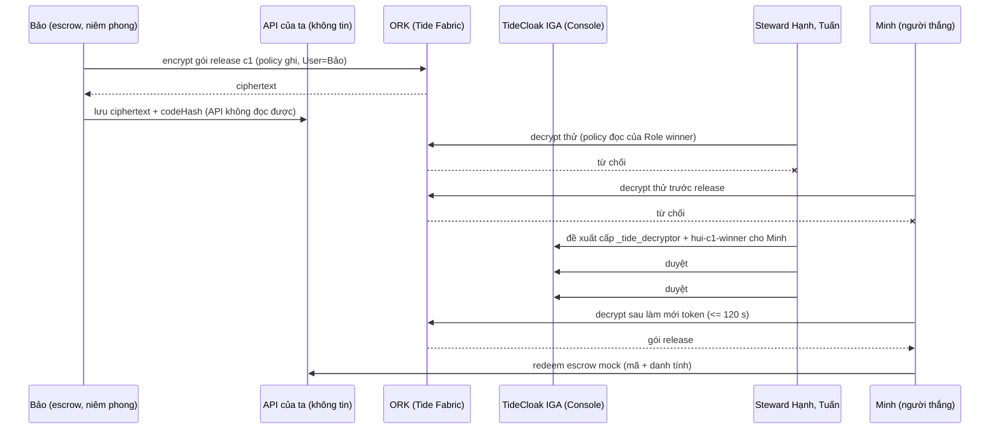

# Phase 03: Lõi payout niêm phong (probe sớm, từ chối, quorum, mở, redeem)

## Context Links

- `.cache/raziel/scenarios/relationship-attestation--scenario.md` (+ `--roles`, `--bootstrap` đặc biệt "Phase 7: Prove it, in this order"), `.cache/raziel/templates/templates/relationship-attestation/{relationship.ts,README.md}`
- `.cache/raziel/canon/iga-change-requests-api.md` (`:190` người đề xuất được tự duyệt, `:199` ngưỡng sống), `.cache/raziel/scenarios/iga-admin-governance--scenario.md` (AP-G07, AP-G08)
- `research/researcher-03-raziel-capabilities-and-scenarios.md` §3–§4, §8; `reports/red-team-review.md`

## Overview

- Priority: P1 · Status: Pending · **G1.5 13:50**, G3 15:15 · B + T cùng làm
- Chứng minh bằng trang thô `/spike` chuỗi thật; **ghi hình lần chạy thành công đầu tiên làm footage dự phòng**. Đây là phần quyết định "Why TideCloak" và "Trust constraint".

## Key Insights

- `RelationshipAttestation:1`: một policy cho mỗi (subject, record); mỗi item **đúng một tag = record id**; `tide-realm-admin` ký policy trong enclave; người dùng cần realm role `_tide_decryptor`/`_tide_encryptor` **và** khớp subject. Ta dùng subject `Role` = `hui-cN-winner`, và **không ai giữ `_tide_decryptor` thường trực**: release CR cấp **cả hai role** cho người thắng.
- Từ chối của ORK hiện dạng `TIDE-TIDEJS-NET-THRESHOLD_FAILURE: Could not reach enough VVK ORKs`; đó là từ chối thật, đọc `cause` để lấy thông điệp contract. Không retry.
- **Phép thử âm phải do ORK từ chối, không phải API**: pack tự dặn "người thứ hai nạp policy của người thứ nhất, **phải bị từ chối**" (bootstrap bước 20). Vì vậy demo phục vụ policy cho **mọi thành viên đã xác thực** (policy chỉ lộ subject + record id, AP-RA07 chấp nhận được trong circle) để steward/Minh thật sự gọi ORK bằng policy hợp lệ của người khác.
- Không dùng master-admin token trong runtime (AP-G08: master "bypass IGA"; chưa rõ trên build này). Đề xuất/duyệt của B0 làm ở **Tide Console**; app chỉ đọc kết quả qua token của người dùng. Hành vi master-token là **thí nghiệm H-op** (đo, không tuyên bố trước).
- Người đề xuất có thể tự duyệt (`:190`), nên "2 phiếu" phải là 2 steward khác nhau.
- Ký policy trong multiAdmin có cần quorum không là **ẩn số U2**; nếu 1 steward ký được, bảo đảm quorum chỉ còn ở việc **cấp role**, và README phải nói đúng như vậy.
- Role mới vào doken sau ≤ 120 s: UI cần trạng thái "propagating", `forceUpdateToken()`.

## Requirements

- Chuỗi proof matrix chạy thật trên `hui-rmit26`, lặp được cho c1 (spike), c3 (quay chính), c4 (dự phòng).
- Không plaintext qua server/log; policy lưu bởi admin sau khi parse đúng subject/record (AP-RA08); route kiểm token + DPoP + role.

## Architecture

Proof matrix (cột "Cơ chế" là thứ video phải nói):

| # | Tác nhân | Hành động | Kết quả phải có | Cơ chế |
|---|---|---|---|---|
| 1 | Host/operator (DB) | đọc `payout-c1` | chỉ thấy ciphertext | E2EE, không giữ khóa |
| 2 | Steward | giải mã c1 bằng policy đọc hợp lệ | bị ORK từ chối | RA: thiếu `_tide_decryptor`/subject |
| 3 | Minh trước release | giải mã c1 | bị từ chối | RA: thiếu role |
| 4 | Steward | đề xuất cấp 2 role cho Minh (Console) | CR PENDING | IGA |
| 5 | Steward #1 duyệt | 1/k, **chưa** commit (k ≥ 2) | IGA quorum |
| 6 | Steward #2 (khác) duyệt | `committed` | IGA quorum |
| 7 | Minh sau refresh | giải mã c1, khớp plaintext | RA |
| 8 | Hai steward vừa duyệt | giải mã c1 | vẫn bị từ chối | tách quyền: duyệt ≠ đọc |
| 9 | Minh | redeem escrow mock | `paid=true` chỉ khi đúng mã + đúng `sub` | logic ứng dụng (nói rõ là mock) |
| 10 | Minh (đang giữ role c1) | giải mã **c3** trước release | bị từ chối | subject theo chu kỳ |

## Related Code Files

- Tạo (B): `src/lib/tide/seal.ts` (bọc `encryptForRecord`/`decryptForRecord`), `src/lib/tide/iga-read.ts` (GET CR bằng token người dùng, chỉ đọc), `src/app/spike/page.tsx` (tạm, xóa ở phase 05), `scripts/tide/experiment-master-grant.sh` (thí nghiệm H-op, không nằm trong app)
- Hoàn thiện route: `src/app/api/{payouts,policies,escrow}/route.ts`
- Ghi nhận (T): `docs/setup-tidecloak.md` mục "Measured behaviour"

## Implementation Steps

1. **S0 (10')** đọc scenario + `relationship.ts` + README template; `tide_scenario_bootstrap relationship-attestation`; nhớ 1 tag/record, policy version lấy từ `Models.Policy.latestVersion`.
2. **G1.5 probe sớm (13:50, sau khi `hanh` đã link và flip):** `hanh` ký policy ghi (User=`bao`) + policy đọc (User=`hanh`, record `probe`), cấp tạm `_tide_decryptor` cho `hanh` (CR do chính `hanh` duyệt khi còn 1 admin), `bao` encrypt, `hanh` decrypt. Xanh ⇒ RA có trên mạng. Rồi **thu hồi** `_tide_decryptor` của `hanh`. Đỏ ⇒ hỏi Tide ngay (nhân viên tại sự kiện + Discord), thử `SimpleTagBasedDecryption:1` tối đa 30 phút **[UNVERIFIED cách dựng policy]**.
3. **S1 ký policy cho c1, c3, c4 (một lượt):** ghi `User=bao`, đọc `Role=hui-cN-winner`; `PUT /api/policies` (admin, parse + đối chiếu subject/record). 6 lần ký.
4. **S2 niêm phong (Bảo):** sinh gói `{cycle, beneficiary:"minh", amountVnd, code}` trong browser (`crypto.getRandomValues`), `encryptForRecord`, `POST /api/payouts` + `POST /api/escrow` (`codeHash`, `beneficiarySub`). Bảo không có policy đọc.
5. **S3 chạy dòng 1, 2, 3, 10:** ghi thông điệp lỗi và `cause`.
6. **S4–S6 quorum (Tide Console):** steward đề xuất, duyệt #1 (xác nhận **chưa** commit), duyệt #2 (commit); ghi `threshold`, `authorizationCount`, thời gian enclave.
7. **S7 mở + redeem:** Minh làm mới token, đợi ≤ 120 s, giải mã, `POST /api/escrow/redeem`; chạy dòng 8.
8. **Ghi hình ngay lần chạy thành công đầu** (QuickTime, 1280×720) làm footage dự phòng; không chờ phase 06.
9. **Thí nghiệm U2 (trước khi thu hồi nếu có):** một mình `hanh` ký policy `User=minh` cho `payout-c3`; Minh (đang giữ `_tide_decryptor` từ c1) có mở được c3 không? Kết quả quyết định lời tuyên bố và có cần thu hồi `_tide_decryptor` sau mỗi chu kỳ (CR + 2 duyệt).
10. **Thí nghiệm H-op:** `scripts/tide/experiment-master-grant.sh`: master token cấp thử role cho một user, đọc hiệu lực (CR pending / áp ngay / ORK vẫn từ chối). Ghi vào docs; **không** đưa vào README trừ khi kết quả có lợi và lặp lại được.
11. Lặp S1–S2 cho c3 và c4 trước 15:15. **G3 15:15.**

Ngân sách chu kỳ: **c1** = spike + footage dự phòng + U2/H-op; **c3** = quay chính (Minh đã giữ role c1 nên dòng 10 là cảnh "người thắng chu kỳ trước bị từ chối"); **c4** = dự phòng. Không dùng lại bản đã mở cho lần quay sau.

| Ẩn số | Phép thử | Nếu xấu |
|---|---|---|
| U1 RA có trên mạng | G1.5 | hỏi Tide; 14:30 vẫn đỏ ⇒ Plan Z |
| U2 ký policy cần quorum? | bước 9 | chỉ tuyên bố "cấp quyền giải mã cần quorum"; thu hồi sau mỗi chu kỳ |
| U3 Role subject + hai role trong một CR | bước 6–7 | tách hai CR; thử Group subject (`groups`, đường dẫn đầy đủ) |
| U4 H-op | bước 10 | không tuyên bố gì về master-admin |
| U5 ngưỡng sống ≥ 2 | phase 01 | README ghi đúng con số đo |

**Plan Z (nếu RA không dùng được lúc 14:30):** đổi thứ được bảo vệ thành *sổ đóng góp riêng của từng thành viên* (self-encryption, operator-blind) + *thành viên/steward chỉ đổi được bằng quorum IGA*; viết lại README/storyboard theo thực tế ("hostless membership + private ledger") và nói rõ phạm vi nhỏ hơn. Không giả lập RA.

## Todo List

- [ ] G1.5 RA probe xanh (hoặc quyết định Plan Z)
- [ ] Policy c1/c3/c4 đã ký; 3 gói đã niêm phong
- [ ] Dòng 1–10 xanh trên `/spike`, có footage dự phòng
- [ ] U2, H-op, ngưỡng đã đo và ghi
- [ ] `/spike` sẵn để xóa ở phase 05

## Success Criteria

- **G3:** dòng 1–10 chạy thật trong một lần liên tục (trừ chờ propagation), có ≥ 2 chu kỳ dự phòng, footage dự phòng đã lưu. Điều kiện duy nhất để giữ lời "needs quorum": phiếu 1 chưa commit, phiếu 2 commit.

## Risk Assessment

- RA vắng mặt: xem U1/Plan Z.
- Popup enclave bị chặn: cho phép popup `localhost` và origin enclave; thử trước giờ quay.
- RAM 8 GB: hai steward duyệt tuần tự, một browser profile mỗi lần.
- Propagation 120 s: quay "propagating" thật, cắt có chú thích.
- Gói niêm phong sai nội dung (bên sinh gói có thể sai): nói trong tài liệu: quorum ủy quyền truy cập, không kiểm nội dung.

## Security Considerations

- Một tag = record id; không đưa dữ liệu vào tag. Không log plaintext/ciphertext đầy đủ. Bên sinh mã (escrow partner) biết mã; escrow mock ràng buộc redeem theo `sub` của người thụ hưởng và `codeHash`. Server không nhận token/doken steward để duyệt (AP-89), không lưu doken (AP-21). Quorum steward có thể thông đồng; client code phải chân thực.

## Next Steps

G3 đạt ⇒ phase 04 nối UI vào luồng thật và phase 05 mở đường công khai sớm; không đạt ⇒ khóa phần đã chứng minh, chuyển sang video.
